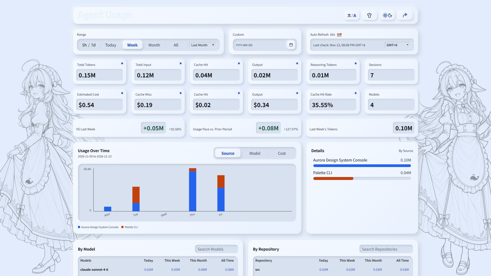
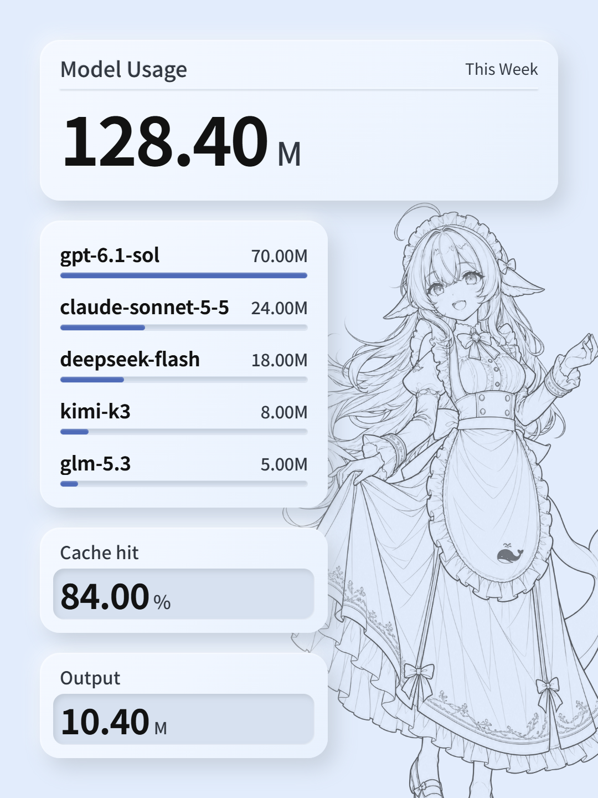
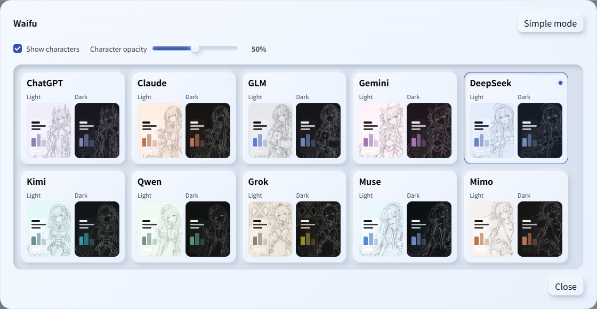

# Agent Usage

[简体中文](README.md) · English

A local dashboard for Codex, ZCode, DSH, OpenCode, Claude Code, WorkBuddy, and [Hermes](docs/data-sources/hermes.md). Track tokens, cache hits, model usage, and cost trends in one place.

Current release: [0.95a](https://github.com/Sylva1027/agent-usage/releases/tag/0.95a).



## Let an Agent Install It

Copy this prompt to your agent:

```text
Install and start Agent Usage on my computer: https://github.com/Sylva1027/agent-usage

1. First ask whether I want character skins: choose Waifu if yes, or Standard if no.
2. Download the selected edition's ZIP asset from the repository's most recent release and extract it to a permanent directory.
3. Check that Node.js meets engines.node in the extracted package.json. If it is missing or incompatible, install a compatible LTS version from https://nodejs.org/ and confirm with node -v. Running this project requires neither npm install nor compilation.
4. Run node src/cli.js run from the extracted project root and verify that http://127.0.0.1:3765/ is accessible. Report the installation directory, access URL, and how to start and stop it later.
```

## Quick Start

We recommend **Node.js 26 LTS** (minimum 23.8). Visit the [official download page](https://nodejs.org/en/download), choose 26 LTS and your system: install the `.msi` on Windows or `.pkg` on macOS with the default options; on Linux, follow the commands on that page. Reopen your terminal and run `node -v` to check the version.

Download [Standard](https://github.com/Sylva1027/agent-usage/releases/download/0.95a/0.95a.zip) or [Waifu](https://github.com/Sylva1027/agent-usage/releases/download/0.95a/0.95a-waifu.zip), extract it, open a terminal in that directory, and run:

```bash
node src/cli.js run
```

Or run from source:

```bash
git clone https://github.com/Sylva1027/agent-usage.git
cd agent-usage
node src/cli.js run
```

Open [http://127.0.0.1:3765/](http://127.0.0.1:3765/). Press `Ctrl+C` to stop the server.

Standard offers a simple interface; Waifu adds character skins. Both editions include the full statistics and image sharing features. Running from source defaults to Waifu, which is shown in the screenshots below.

Some character designs in Waifu come from [ZipZipPipe](https://space.bilibili.com/4168597). Thank you for your work.

## Dashboard

- **Time trends:** Explore daily, weekly, monthly, or custom ranges, with views by source, model, and cost.
- **Codex limits:** See usage in the current and previous five-hour and weekly allowance windows.
- **Usage details:** Inspect input, output, and cache hits; search and sort by model, source, or repository.
- **Period comparisons:** Compare with the preceding period to spot changes and new records.
- **Share images:** Select today, this week, or this month, then use the rightmost header button to create a 3:4 card for phone viewing. Copy or save the PNG.
- **Source management:** Automatically scan local logs and confirm before importing, with stages and elapsed time shown. Import other directories, refresh automatically, or pause.
- **Language and appearance:** Switch between Chinese and English or light and dark themes. Waifu adds ten character skins with visibility and opacity controls.





## Cost Estimates

Estimate input, output, and cache costs using each model's API rates, displayed in USD or CNY. Prices and exchange rates update automatically and can also be edited manually.

The pricing dialog groups models you have used by manufacturer, with search for manufacturers and models. Models are ordered by release date. Select a model to view or edit its rates, then save to recalculate costs. Model names omit routing prefixes.

## Commands

```bash
node src/cli.js summary        # Terminal summary
node src/cli.js summary --json # JSON output
```

Licensed under the [MIT License](LICENSE).
