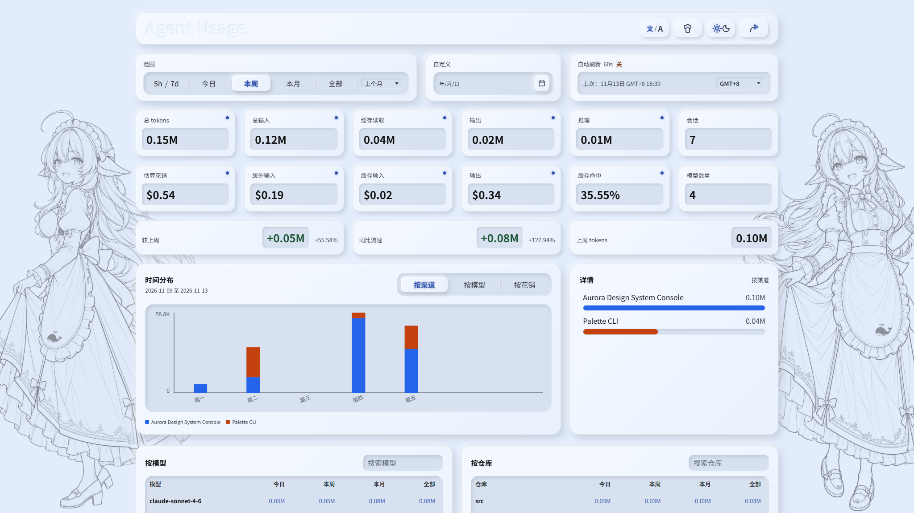
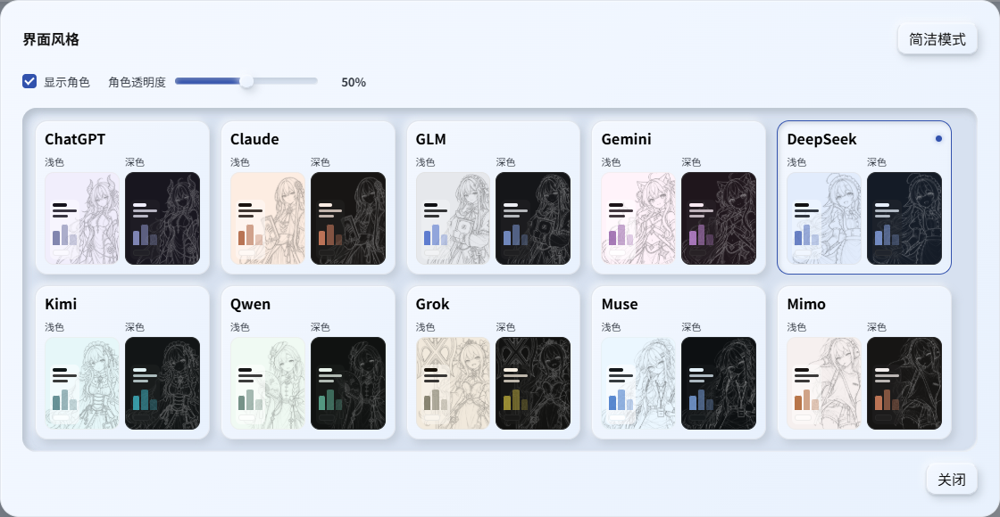

# Agent Usage

简体中文 · [English](README.en.md)

把 Codex、ZCode、DSH、OpenCode、Claude Code 和 WorkBuddy 的用量汇总到一个本地看板，查看 Token、缓存命中、模型使用与费用趋势。

当前版本：[0.95](https://github.com/Sylva1027/agent-usage/releases/tag/0.95)。



## 快速开始

推荐安装 **Node.js 26 LTS**（最低要求 23.8）。打开 [官方下载页](https://nodejs.org/en/download)，选择 26 LTS 和你的系统：Windows 下载 `.msi`、macOS 下载 `.pkg`，按默认选项安装；Linux 按页面命令安装。重新打开终端，运行 `node -v` 确认版本。

下载 [标准版](https://github.com/Sylva1027/agent-usage/releases/download/0.95/0.95.zip) 或 [waifu 版](https://github.com/Sylva1027/agent-usage/releases/download/0.95/0.95-waifu.zip)，解压后在该目录打开终端，运行：

```bash
node src/cli.js run
```

也可以从源码启动：

```bash
git clone https://github.com/Sylva1027/agent-usage.git
cd agent-usage
node src/cli.js run
```

打开 [http://127.0.0.1:3765/](http://127.0.0.1:3765/)，按 `Ctrl+C` 停止服务。

标准版提供简洁界面；waifu 版增加角色皮肤。两版均提供完整统计和分享功能，源码运行默认为 waifu 版。下方截图展示 waifu 版。

waifu 版部分角色形象来自 [ZipZipPipe](https://space.bilibili.com/4168597)，感谢其创作。

## 看板功能

- **时间趋势：** 按日、周、月或自定义日期查看用量，切换渠道、模型和费用视图。
- **Codex 额度：** 查看当前和上一轮 5 小时、每周额度窗口的用量。
- **用量明细：** 查看输入、输出和缓存命中，按模型、渠道或仓库搜索、排序。
- **周期对比：** 与上一周期比较，发现用量变化和新纪录。
- **分享图片：** 选择今日、本周或本月，用标题栏最右侧按钮生成适合手机阅读的 3:4 图片，复制或保存 PNG。两个辅助指标可自选并记住选择，费用默认隐藏，开启后显示整数 API 估算。图片跟随当前皮肤、深浅模式与人物显隐；后台刷新时也可分享点击那一刻的数据。
- **来源管理：** 自动扫描本机日志，确认后导入，显示阶段和已用时间；也可导入其他目录，支持自动刷新和暂停。
- **语言与外观：** 中英文界面、深浅主题；waifu 版提供十款角色皮肤，可调整角色显示与透明度。



## 费用估算

按模型的 API 单价估算输入、输出和缓存费用，可选择以美元或人民币查看。价目与汇率自动更新，也可手动调整。

模型名称自动去除路由来源前缀，统计、排行和计价使用同一模型身份。在计价窗口中，缺少费率的模型也可直接点击填写单价，再保存并重新计算。

## 命令

```bash
node src/cli.js summary        # 终端汇总
node src/cli.js summary --json # JSON 输出
```

项目采用 [MIT License](LICENSE)。
