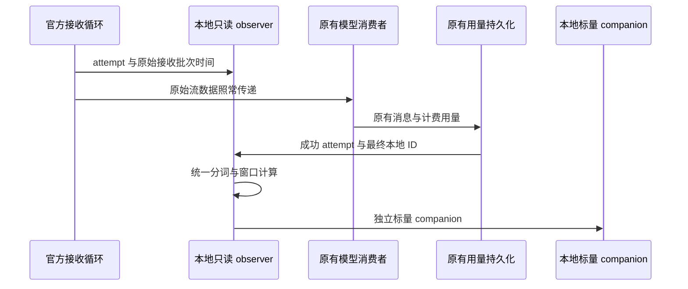

# WorkBuddy Desktop 与 Claude 本地 TPS 接口方案

本方案保留官方原版客户端、既有账号与路由，通过官方扩展或官方本地日志取得生成速度证据。当前只准备接口与社区方案，不安装采集组件、不调整客户端配置。来自搜索的新做法须先向用户解释并获准，再实施。

## 要补的事实

生成速度需要同一成功响应的可见输出与对应接收窗口。现有消息完成时间、整次请求时长和工具生命周期不足以恢复这些事实；参考 token 仍由 Agent Usage 的统一分词器计算。

最小接口有三类通知，字段名是本方案的建议，不冒充已经存在的 SDK：

1. `attemptStarted`：物理 `attemptId`、本地 session、模型与 provider。同一逻辑调用的失败重试必须有不同 attempt 身份。
2. `received`：attempt、单调接收时间、接收批次 ID、原始流字节。通知发生在消费者队列、协议事件合批与 UI 发布之前；同一批可以分多次通知，共享同一时间与批次身份，不要求为观察再合并或缓存正文。
3. `attemptFinished`：成功、失败或取消状态，以及原生 response/message ID 到最终本地消息或 usage 行的确切绑定。网络开始时尚无最终本地 ID，可以在这里补齐。

时钟单位、原点和批次边界必须声明；同一测量内保持一致。原始流字节只在进程内供只读 observer 解析，不新增正文日志。回调不能改写请求、响应或消费结果；observer 出错只使该次测量失效。完成后的 companion 仅保存身份、参考计数和窗口。

无需新增请求开始到工具结束的完整 tracing 系统，也无需厂商采用我们的 tokenizer。若官方选择本地日志而非回调，日志必须保留等价的接收时序和准确身份；仅记录最终正文或最后一个 chunk 的时间不能替代。

## WorkBuddy Desktop

已核验 5.9.4 的正式扩展事件在 ACP、状态合并与批处理之后；现有 CLI 的 Node HTTP collector 未进入普通 Desktop sidecar。插件安装成功不等于接收入口已经接通。

最小上游改动是让正常 sidecar 支持上面的只读 observer，并通过正式扩展注册与卸载。这样可复用现有 WorkBuddy collector、localMessage/session 关联和 reader。若厂商只提供本地标量 producer，应同时说明参考计数与窗口的生成语义；原生计费 token 除以请求时长不能直接写成 v8。

验收针对实际 Desktop 启动链：一次分批输出产生有效测量；一次整批输出不能因为下游慢消费而生成假窗口；一次失败后重试只关联成功响应。仅 CLI 正例、扩展事件正例或 localhost 工具调用不足以代替。

## Claude

已检查的官方 2.1.309 中，partial stream 保留 API 事件但缺原始接收批次时间；debug 时间是日志调用时间；`requestLogID` 没有随每个输出事件传递。现有 watchdog 的最后 chunk 时间不能还原整条流。

最小上游改动可放在现有 SSE body 读取位置：加入可选只读接收通知，沿用真实 API `message.id`，并在完成时绑定 transcript 消息。retry 使用各自的 attempt 身份。CLI、Desktop、子代理分别以实际装配入口声明覆盖，不能把 SDK 可构造的 observer 当作所有普通启动路径均已支持。

另一种可讨论的官方实现是本地诊断记录：在原接收点写入带批次与时间的事件，并提供最终身份索引。它会增加原始输出日志体积，须先说明是否含正文、轮转与清理成本；本轮没有启用。官方 [Monitoring](https://code.claude.com/docs/en/monitoring-usage) 提供现有遥测与 raw-body 记录说明，但这些选项本身不能证明逐接收计时存在。

## 社区实现的参考结论

这些项目仅作源码和文档参考，未安装或执行。固定源码与本机检查记录位于 `.codex-usage/tps-upstream-20261031/community/`。

- [Claude Profiler](https://github.com/jlxue/claude_profiler/tree/0387ca1acb0b2b8a2389127160a68ddb3ed23c66)：`conversation.py` 从第一条非 thinking 消息时间到最后 assistant 时间计算跨度，并按 thinking 与正文字符比例拆分原生输出 token。优点是纯本地、只读历史、易启用；代价是消息发布时间不等于接收时间，字符比例也不是统一参考分词。它可以形成估计口径，不能直接填入当前 v8。
- [TokenScope](https://github.com/SleepAviator/tokenscope/tree/41bfa270d33da7d28996acdde5d79a5ecc145a38)：部分历史数据来自 CC-Switch 请求记录；实时部分将收到的用量报告分摊到滑动窗口。作者也说明合批报告会产生尖峰，未观察到的网络 chunk 无法重建。可参考其去重、迟到处理与本地 OTLP 接入，不能把报告到达时间变成生成时间。其代理数据路径不符合本项目当前接入范围。
- [WorkBuddy2API Panel](https://github.com/Arthur-dlz/workbuddy2api-panel)：作者公开说明这是 OpenAI 兼容网关，提供 TTFB 和 tok/s。它处在实际请求流上，因此有观察接收的条件，但属于转发路径，不是被动读取普通 Desktop。这里只核验了作者文档；该仓库源码本轮未成功取得，具体 TPS 公式没有作为已证实结论。
- [Claude statusline 的 transcript 汇总说明](https://github.com/turboza/claude-code-statusline-live/blob/main/docs/learnings/04-transcript-jsonl-aggregation.md)：可借鉴低成本读取已有 transcript 的方式；文档没有提供恢复原始接收批次的方法。

本轮搜索尚未找到可以直接补齐上述两个普通客户端、同时符合现有接入约束的实现。若选择社区的历史估计或显示速率，就会改变统计含义；应先明确解释并取得用户批准，单独定义方法版本，不能悄悄替换当前生成速度。

另有可供后续研究的官方底层能力：[Undici diagnostics channel](https://github.com/nodejs/undici/blob/main/docs/docs/api/DiagnosticsChannel.md) 提供 `bodyChunkReceived`，可以在同一 Node 进程内旁观实际收到的响应字节。当前 Node 24.19.0 / Undici 7.29.0 的一次本地合成 HTTP 对照确认，消费者延迟读取时仍收到三个原始块通知；没有安装到任何客户端。这只是底层能力证明：WorkBuddy 的 Node HTTP/Axios 路径、Claude 的实际运行时、压缩以及同进程加载入口都需各自验证，不能据此声称它们已经可用。若拟将搜索得到的此类路径用于闭源客户端，应先向用户说明正常启动方式和覆盖边界并获准，再实施；本轮只保留方案。

## 后续交付条件

开源来源先准备可应用、带专项测试的上游候选补丁；闭源来源保留这份可直接交给厂商的接口要求与有界验收场景。对外 issue、PR 或厂商消息均未提交。只有正式客户端实际提供相应能力并完成正常启动验证，才将对应运行模式计为已支持。

当前已可用来源继续统计；RANGE、计费用量和页面结构保持原行为。详细执行状态见 [TPS harness 修复方案](2026-10-31-tps-harness-repair-plan.md)。
